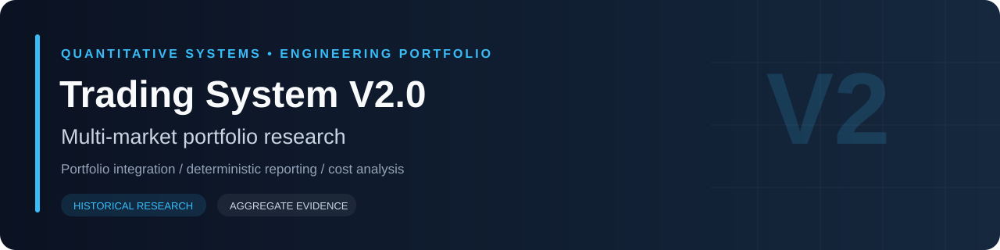
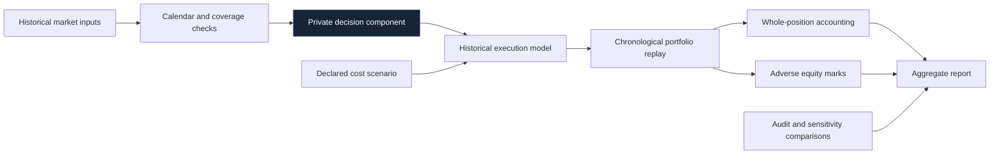
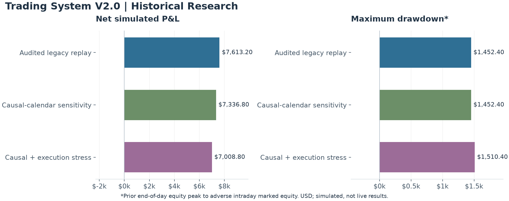

# Trading System V2.0

**Combining independent market streams into one auditable portfolio view.**

Built the portfolio research workflow, a common historical replay/reporting path, and a Python/C# event interface. The public evidence here focuses on the historical reporting and audit layer.

| Project lens | Evidence type | Implementation | Public artifacts |
|---|---|---|---|
| Multi-market portfolio research | Historical simulation and preserved audits | Private | Architecture, methods, aggregate results |

**Explore:** [System design](docs/ENGINEERING.md) · [Measurement methodology](docs/METHODOLOGY.md) · [Detailed results](docs/RESULTS.md) · [Machine-readable metrics](metrics.json)

## The engineering problem

Two individually plausible market reports do not automatically produce a valid combined portfolio. Event order, shared state, transaction costs and whole-position accounting must agree before an aggregate result is useful.

## System at a glance

The diagram is a conceptual view of the research workflow. It describes logical responsibilities, not a deployment topology or an executable trading specification.

## Engineering dimensions

| Dimension | What the project examines | Why it matters |
|---|---|---|
| Temporal integrity | Which information exists at each research step | Reduces future-information leakage |
| State evolution | How earlier events affect later eligibility and equity | Prevents treating dependent decisions as isolated observations |
| Execution assumptions | Costs, adverse marks and minute-bar limitations | Makes reported performance interpretable |
| Measurement | Consistent position counts, net results and drawdown definitions | Avoids misleading headline comparisons |
| Evidence discipline | Preserved snapshots, controls and explicit limitations | Separates reproducible output from unsupported claims |

## Historical evidence snapshot

**January 2–October 1, 2026 · minute-bar simulation · snapshot audited October 13, 2026.** These are inspected development results, not prospective performance.

| Scenario | Net P&L | Maximum drawdown* | Positions | Win rate | Profit factor |
|---|---:|---:|---:|---:|---:|
| Audited legacy replay | $7,613.20 | $1,452.40 | 118 | 51.69% | 1.68 |
| Causal-calendar sensitivity | $7,336.80 | $1,452.40 | 117 | 51.28% | 1.65 |
| Causal + execution stress | $7,008.80 | $1,510.40 | 117 | 51.28% | 1.62 |

\* Maximum drawdown uses the highest prior end-of-day equity minus adverse intraday marked equity, not the highest intraday equity. Net P&L is after the modeled costs described in [Methodology](docs/METHODOLOGY.md). No new replay was run for this presentation update.

## A finding that changed the interpretation

An apparently small reporting choice can change a headline metric. The audited whole-position win rate is 51.69%, correcting an earlier summary that counted results differently.

## Evidence and boundaries

| Supported here | Not established by this showcase |
|---|---|
| Aggregate figures checked against preserved research artifacts | Future returns or independent out-of-sample effectiveness |
| Explicit historical cost and drawdown definitions | Tick-accurate fills, latency or queue priority |
| Separately labeled sensitivity scenarios | Complete operational reliability |
| High-level engineering responsibilities | A reproducible public trading policy |

The public material omits implementation details and decision logic. No prospective paper or live results are published. Research-period selection and model uncertainty remain material limitations.

## Reading guide

- **[Engineering](docs/ENGINEERING.md):** component responsibilities, logical data contracts, sequencing and assurance gaps.
- **[Methodology](docs/METHODOLOGY.md):** metric definitions, effective cost assumptions and interpretation limits.
- **[Results](docs/RESULTS.md):** complete preserved tables and derived comparisons.
- **[Metrics JSON](metrics.json):** compact, machine-readable aggregate values.

## Portfolio context

[Version 2.0](https://github.com/miahaa/trading-system-v2-showcase) · [Version 3.0](https://github.com/miahaa/trading-system-v3-showcase) · [Version 4.0](https://github.com/miahaa/trading-system-v4-showcase) · [Version 7.0](https://github.com/miahaa/trading-system-v7-showcase)

These projects use different configurations, datasets and research objectives. Their results are not a controlled version ranking. Historical simulation results do not predict future returns.
